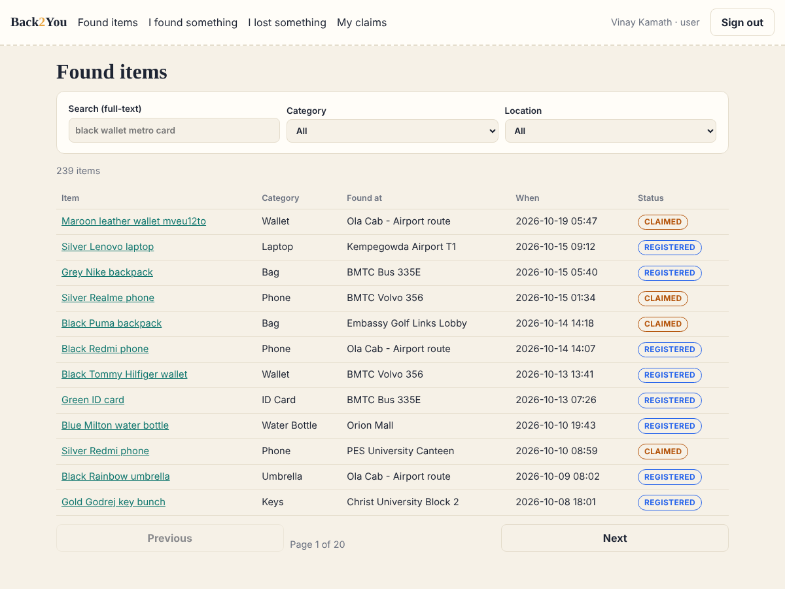
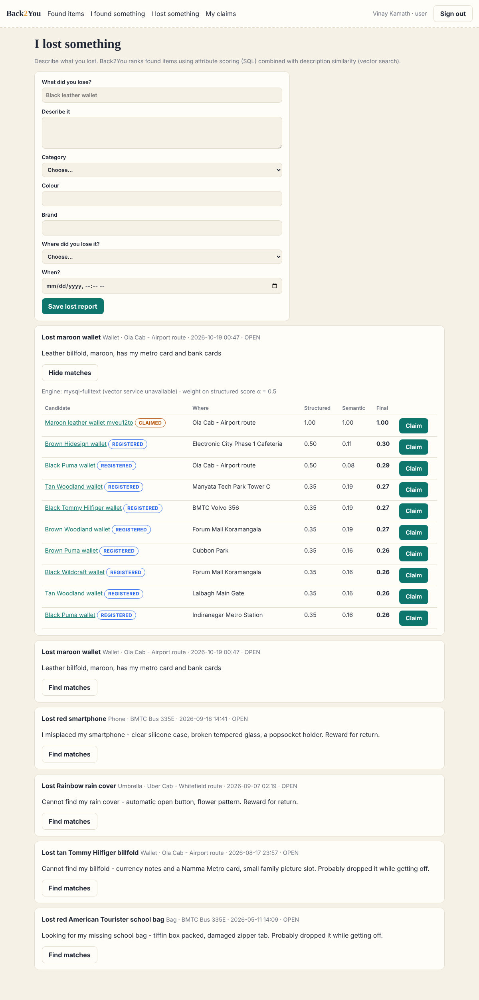
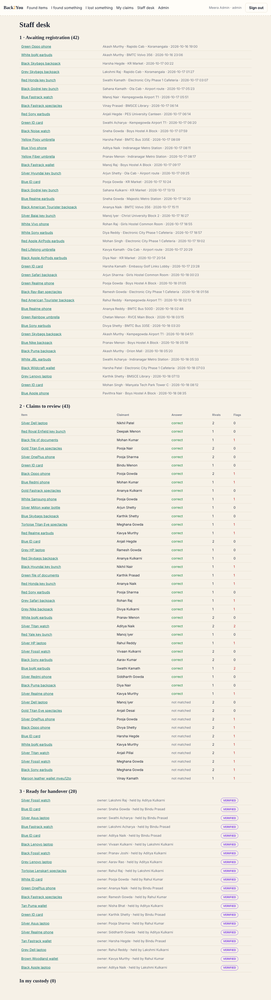

# Back2You – Lost Item Return & Ownership Management System

Back2You is a web-based Lost and Found Management System designed to simplify the process of reporting, identifying, claiming, verifying, and returning lost items.

The system combines a **Next.js web application, MySQL database management, database-level business logic, and AI-powered semantic matching** to help connect lost-item reports with registered found items.

It also implements role-based access control, fraud detection, custody tracking, and an immutable audit trail to ensure secure and transparent item recovery.

---

## Table of Contents

- [Project Overview](#project-overview)
- [Key Features](#key-features)
- [System Architecture](#system-architecture)
- [Technology Stack](#technology-stack)
- [How It Works](#how-it-works)
- [AI-Based Matching System](#ai-based-matching-system)
- [Database Design](#database-design)
- [User Roles](#user-roles)
- [Project Structure](#project-structure)
- [Installation and Setup](#installation-and-setup)
- [Environment Configuration](#environment-configuration)
- [Running the Application](#running-the-application)
- [Testing](#testing)
- [Security and Integrity](#security-and-integrity)
- [Screenshots](#screenshots)
- [Future Enhancements](#future-enhancements)

---

## Project Overview

Traditional lost and found systems often depend on manual searches and communication between individuals. This can make it difficult to identify the correct owner, verify ownership, and maintain a reliable record of item transfers.

Back2You addresses these challenges through an integrated platform where:

1. Users can report items they have lost.
2. Finders can register items they have discovered.
3. The system identifies potentially matching lost and found records.
4. Owners can submit claims and answer verification questions.
5. Staff members review claims and manage item handovers.
6. Administrators monitor system activity, fraud indicators, and overall performance.

The project emphasizes database-driven business logic, data consistency, transaction safety, and intelligent item matching.

---

## Key Features

### 1. Lost and Found Item Management
- Register newly found items.
- Submit lost-item reports.
- Browse available found items.
- View individual item details and status.
- Track reported items and claims.

### 2. Intelligent Item Matching
- Structured matching using item attributes.
- Semantic similarity using text embeddings.
- Vector similarity search using Qdrant.
- MySQL FULLTEXT fallback when the vector service is unavailable.
- Ranked matching results based on a hybrid scoring mechanism.

### 3. Ownership Verification
- Users submit claims for found items.
- Verification questions help establish ownership.
- Answers are checked against stored verification information.
- Limited verification attempts.
- Staff approval before final handover.
- Competing claims are handled automatically.

### 4. Role-Based Access Control
The system supports three roles:

- **User:** Reports lost items, registers claims, and tracks recovery.
- **Staff:** Registers found items, reviews claims, and manages handovers.
- **Admin:** Manages users, monitors fraud flags, views analytics, and verifies audit records.

### 5. Custody Management
- Tracks the current custodian of every item.
- Maintains custody history.
- Records item handovers.
- Prevents unauthorized transfers.
- Ensures only the current custodian can complete a handover.

### 6. Fraud Detection
The system identifies suspicious activities such as:

- Multiple claimants for the same item.
- Excessive claims.
- Repeated incorrect verification answers.

Administrators can review, confirm, or dismiss fraud flags.

### 7. Audit Trail and Data Integrity
- Append-only audit records.
- Hash-chained audit logs.
- Audit chain verification.
- Detection of historical record tampering.
- Immutable custody and handover history.

### 8. Admin Dashboard
Provides insights into:
- Total registered items.
- Item return rate.
- Average time taken for returns.
- Pending claims.
- Open fraud flags.
- Items grouped by status and category.
- Unclaimed items by location.
- Staff workload.
- Database audit history.

---

## System Architecture

Back2You follows a layered architecture in which the frontend, API layer, relational database, and vector search engine work together.

```text
                 USER / STAFF / ADMIN
                          |
                          v
                NEXT.JS FRONTEND
                          |
                          v
                  NEXT.JS API ROUTES
                          |
             +------------+------------+
             |                         |
             v                         v
        MYSQL DATABASE             AUTHENTICATION
             |                         |
             |                    JWT + bcrypt
             |
     +-------+--------+
     |       |        |
     v       v        v
   Tables  Triggers  Stored Procedures
     |       |        |
     +-------+--------+
             |
             v
       MATCHING ENGINE
             |
       +-----+------+
       |            |
       v            v
  STRUCTURED     SEMANTIC
   MATCHING      MATCHING
       |            |
       v            v
     MySQL        Qdrant
                  Vector DB
       |            |
       +-----+------+
             |
             v
       RANKED RESULTS
             |
             v
       FRONTEND DISPLAY
```

---

## Technology Stack

| Component | Technology |
|---|---|
| Frontend | React 19 |
| Framework | Next.js 15 |
| Backend | Next.js API Routes |
| Programming Language | JavaScript |
| Database | MySQL 8 |
| Database Connectivity | mysql2 |
| Database Logic | SQL, Triggers, Stored Procedures, Functions |
| Vector Database | Qdrant |
| Embedding Model | all-MiniLM-L6-v2 |
| Embedding Framework | Transformers.js |
| Authentication | JWT (jose) |
| Password Security | bcryptjs |
| Validation | Zod |
| Containerization | Docker |
| Testing | Node.js Test Scripts |

---

## How It Works

The item recovery process follows a controlled lifecycle.

```text
FOUND
  |
  v
REGISTERED
  |
  v
CLAIMED
  |
  v
VERIFIED
  |
  v
HANDED_OVER
  |
  v
RETURNED
```

### Step 1: Found Item Registration

A finder or staff member registers a discovered item with information such as:

- Item name
- Category
- Color
- Brand
- Description
- Location
- Date found

### Step 2: Lost Item Reporting

A user submits a report containing the details of their missing item.

### Step 3: Matching

The matching engine compares the lost report with registered found items and generates ranked matches.

### Step 4: Claim Submission

The user selects a potentially matching item and submits an ownership claim.

### Step 5: Ownership Verification

The user answers a verification question associated with the item.

The system checks the answer and tracks the number of attempts.

### Step 6: Staff Approval

Staff members review pending claims and approve the appropriate claimant.

Competing claims are handled according to the database rules.

### Step 7: Item Handover

The item is handed over by the authorized current custodian.

The transaction records the handover and updates custody information.

### Step 8: Return Confirmation

The owner confirms receipt of the item, completing the recovery lifecycle.

---

## AI-Based Matching System

One of the major components of Back2You is its hybrid matching engine.

Instead of relying only on exact text matches, the system combines structured database matching with semantic similarity.

### 1. Structured Matching

MySQL compares item attributes such as:

- Category
- Color
- Brand
- Location
- Time information

A database function named `fn_match_score` calculates the structured matching score.

The stored procedure `sp_candidates` retrieves and ranks candidate items.

### 2. Semantic Matching

Semantic matching identifies similarities between descriptions even when users use different words to describe the same object.

For example:

- Lost report: "Black wireless headphones."
- Found item: "Dark Bluetooth headset."

The descriptions may differ, but their meaning can be similar.

The system uses:

**Xenova/all-MiniLM-L6-v2**

- Converts text into numerical vector embeddings.
- Uses 384-dimensional embeddings.
- Applies mean pooling and normalization.
- Enables semantic similarity comparison.

Transformers.js is used to generate the embeddings.

### 3. Vector Search Using Qdrant

Qdrant stores item embeddings and performs similarity searches using cosine similarity.

The system retrieves relevant candidate items and combines their semantic scores with structured matching scores.

### 4. Hybrid Scoring

The final matching score combines structured and semantic scores.

\[
FinalScore = \alpha \times StructuredScore
\]

\[
+ (1-\alpha) \times SemanticScore
\]

Where:

- `StructuredScore` represents attribute-based matching.
- `SemanticScore` represents semantic similarity.
- `α` is controlled by the `MATCH_ALPHA` environment variable.
- Default value of α is 0.5.

### 5. Fallback Mechanism

If Qdrant is unavailable, the system automatically falls back to MySQL FULLTEXT matching.

If the MiniLM embedding model cannot be loaded in automatic mode, an offline feature-hashing embedding mechanism is used.

This allows matching functionality to remain available even when external vector or model services are unavailable.

---

## Database Design

MySQL acts as the primary source of truth for the application.

The database handles important business rules rather than depending entirely on application-level validation.

### Database Components

| Component | Purpose |
|---|---|
| Tables | Store users, items, claims, reports, and other records |
| Primary Keys | Uniquely identify records |
| Foreign Keys | Maintain relationships between tables |
| Constraints | Enforce valid data |
| Triggers | Enforce lifecycle and integrity rules |
| Stored Procedures | Handle complex database operations |
| Functions | Calculate matching scores and other values |
| Indexes | Improve query performance |
| Views | Provide controlled and reusable data access |

### Important Database Operations

- Item lifecycle validation.
- Claim verification.
- Custody transfers.
- Atomic handover transactions.
- Fraud flag generation.
- Audit logging.
- Concurrent claim handling.

### ER Diagram

The database entity relationship diagram is available here:

`docs/ER_DIAGRAM.md`

---

## User Roles

| Role | Responsibilities |
|---|---|
| User | Report lost items, browse found items, submit claims, verify ownership |
| Staff | Register found items, review claims, manage custody and handovers |
| Admin | Manage users, monitor analytics, review fraud flags, verify audit logs |

Role permissions are checked from the database on every authenticated request.

---

## Project Structure

```text
back2you/
│
├── app/
│   ├── admin/
│   ├── claims/
│   ├── items/
│   ├── lost/
│   ├── login/
│   ├── report/
│   ├── staff/
│   │
│   └── api/
│       ├── admin/
│       ├── auth/
│       ├── claims/
│       ├── items/
│       ├── lost-reports/
│       ├── my/
│       ├── public/
│       ├── staff/
│       └── vector/
│
├── components/
│   ├── Nav.js
│   ├── ui.js
│   └── useApi.js
│
├── lib/
│   ├── api.js
│   ├── auth.js
│   ├── db.js
│   ├── embeddings.js
│   ├── matching.js
│   ├── qdrant.js
│   ├── showcase-queries.js
│   └── vector-sync.js
│
├── db/
│   ├── 01_schema.sql
│   ├── 02_functions.sql
│   ├── 03_triggers.sql
│   ├── 04_procedures.sql
│   ├── 05_migration_alter_drop.sql
│   ├── 06_indexes.sql
│   ├── 07_views.sql
│   └── queries.sql
│
├── scripts/
│   ├── db-setup.js
│   ├── seed.js
│   ├── seed-data.js
│   ├── migrate.mjs
│   ├── sync-vectors.mjs
│   └── evaluate-matching.mjs
│
├── tests/
│   ├── 01_state_machine.test.mjs
│   ├── 02_concurrency.test.mjs
│   ├── 03_integrity_audit_fraud.test.mjs
│   ├── 04_matching_vector.test.mjs
│   ├── db.test.js
│   ├── smoke-journey.mjs
│   └── e2e/
│
├── docs/
│   ├── ER_DIAGRAM.md
│   ├── MATCHING_EVALUATION.md
│   ├── EXPLAIN_RESULTS.md
│   ├── test-results.md
│   └── screenshots/
│
├── data/
├── public/
├── .env.example
├── .gitignore
├── docker-compose.yml
├── package.json
└── README.md
```

---

## Installation and Setup

### Prerequisites

Make sure the following tools are installed:

- Node.js 20 or later
- npm
- MySQL 8
- Docker Desktop (optional, for running MySQL and Qdrant using Docker)
- Git

### Step 1: Clone the Repository

```bash
git clone <YOUR_GITHUB_REPOSITORY_URL>
```

Navigate into the project directory:

```bash
cd back2you
```

### Step 2: Install Dependencies

```bash
npm install
```

### Step 3: Configure Environment Variables

Create your environment file:

```bash
cp .env.example .env
```

On Windows Command Prompt, use:

```cmd
copy .env.example .env
```

Update the database credentials and JWT secret in `.env`.

### Step 4: Start Database Services

If using Docker:

```bash
docker compose up -d
```

This starts:

- MySQL 8 on port 3306.
- Qdrant on port 6333.

For Docker, configure `DB_ADMIN_PASSWORD` in `.env` to match the MySQL root password used by the Compose configuration.

If MySQL is already installed locally, you can use that instead.

### Step 5: Initialize the Database

```bash
npm run db:reset
```

This script:

- Creates the Back2You database.
- Loads the SQL schema.
- Creates database functions.
- Creates triggers and stored procedures.
- Applies indexes and views.
- Configures the application database account.

**Warning:** The database reset process drops and recreates the `back2you` database. Do not run it if you have data you need to preserve.

### Step 6: Insert Sample Data

```bash
npm run db:seed
```

This populates the database with demonstration users, items, claims, and handover records.

### Step 7: Start the Application

Development mode:

```bash
npm run dev
```

Production mode:

```bash
npm run build
npm start
```

Open the application:

http://localhost:3000

---

## Environment Configuration

The project uses environment variables to manage database connectivity, authentication, and vector search.

| Variable | Description |
|---|---|
| DB_HOST | MySQL host |
| DB_PORT | MySQL port |
| DB_NAME | Database name |
| DB_USER | Database administrator username |
| DB_PASSWORD | Database administrator password |
| DB_APP_USER | Application database username |
| DB_APP_PASSWORD | Application database password |
| JWT_SECRET | Secret used for JWT authentication |
| EMBEDDING_PROVIDER | Embedding provider selection |
| QDRANT_URL | Qdrant server URL |
| QDRANT_COLLECTION | Vector collection name |
| MATCH_ALPHA | Weight used for structured matching |

Refer to `.env.example` for the complete configuration.

Never commit your actual `.env` file or database credentials to GitHub.

---

## Running the Application

After starting the application, open:

http://localhost:3000

The application provides separate interfaces for:

- General users.
- Staff members.
- Administrators.

### Demo Accounts

The seed script provides the following demonstration accounts:

| Role | Email | Password |
|---|---|---|
| Admin | admin@back2you.dev | Admin@123 |
| Staff | staff1@back2you.dev | Staff@123 |
| User | user1@back2you.dev | User@123 |

These credentials are for local demonstration purposes only. Change them before any real deployment.

---

## Testing

The project includes database, integration, concurrency, integrity, and matching tests.

### Run Database Tests

```bash
npm test
```

Tests cover:

- Item lifecycle transitions.
- Invalid state transition prevention.
- Ownership verification.
- Claim management.
- Role enforcement.
- Custody management.
- Fraud detection.
- Audit trail integrity.
- Database constraints.
- Concurrent claims.
- Concurrent handovers.
- Matching score calculations.

### Run Smoke Tests

Start the application first, then run:

```bash
npm run test:smoke
```

The smoke test validates the main HTTP application journey.

The default base URL is:

```text
http://localhost:3000
```

### Test Results

The recorded database test results show:

**25 / 25 tests passed.**

Important validations include:

- Full item recovery lifecycle.
- Rejection of illegal status transitions.
- Atomic handover transactions.
- Detection of audit-log tampering.
- Concurrent claim handling.
- Prevention of duplicate successful handovers.
- Audit chain verification after concurrent operations.

Detailed results are available in:

`docs/test-results.md`

---

## Security and Integrity

Back2You implements multiple mechanisms to protect application data.

### Authentication
- JWT-based authentication.
- Password hashing using bcryptjs.
- Role-based authorization.

### Database Integrity
- Primary and foreign key constraints.
- CHECK constraints.
- Database triggers.
- Controlled stored procedure operations.

### Transaction Management
- Atomic handover operations.
- Rollback on transaction failure.
- Concurrency handling.
- Deadlock and lock-wait retries.

### Audit Integrity
- Append-only audit records.
- Hash-chained audit logs.
- Historical tampering detection.
- Verification of the audit chain.

---

## Screenshots

### 1. Found Items



### 2. Lost Item Matching



### 3. Item Details


### 4. Staff Dashboard



### 5. Admin Dashboard


---

## Future Enhancements

Potential improvements include:

- Image-based item similarity matching.
- Improved semantic ranking using larger embedding models.
- Email and notification integration.
- Mobile application support.
- Advanced fraud detection.
- Real-time notifications for claim updates.
- Deployment to a cloud infrastructure.
- Enhanced analytics and reporting.

---

## Project Information

**Project Name:** Back2You

**Project Type:** Full-Stack Web Application / DBMS Project

**Domain:** Lost and Found Management

**Core Focus:**
- Database Management Systems
- Full-Stack Development
- AI-Based Semantic Search
- Vector Databases
- Transaction Management
- Data Integrity and Security

---

## Contributors

Developed as an academic project with a focus on building a reliable, database-driven lost and found management platform.

---

**Back2You – Helping Lost Items Find Their Way Back Home.**
